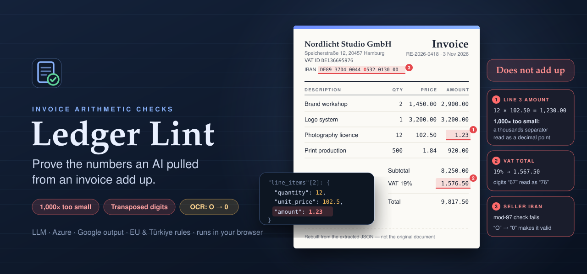
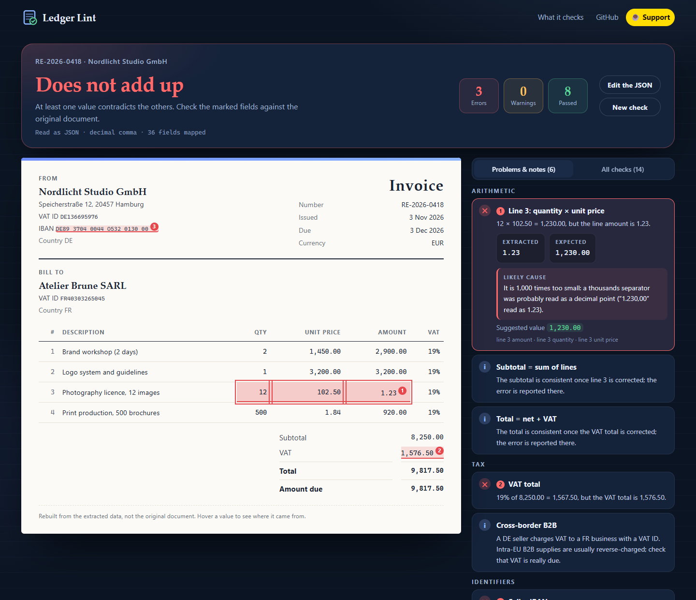
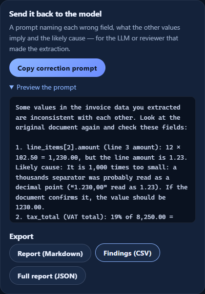
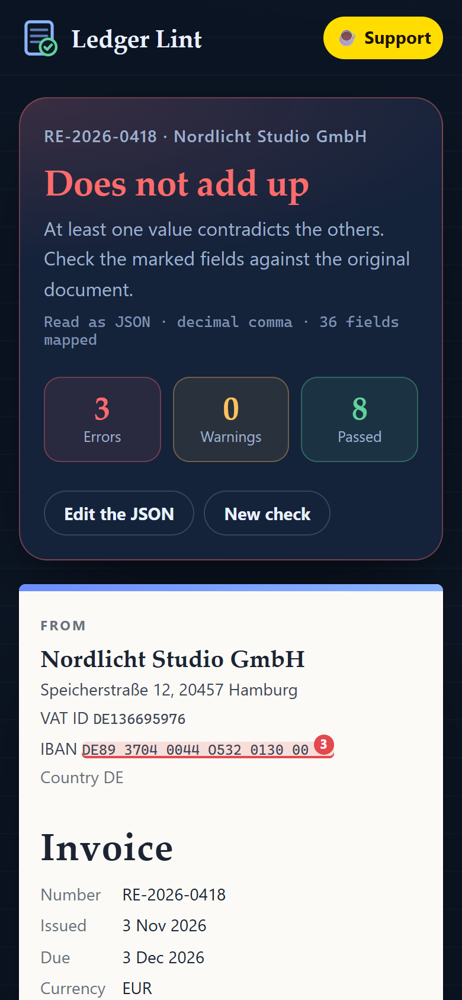

<p align="center">
  
</p>

<h3 align="center">Valid JSON can still contain invalid arithmetic.<br>Review extracted invoices, investigate likely errors, and keep the evidence beside the numbers.</h3>

<p align="center">
  <a href="https://ledger-lint.vercel.app/"><b>Live demo ↗</b></a> ·
  <a href="#quick-start"><b>Quick start</b></a> ·
  <a href="#what-it-checks">What it checks</a> ·
  <a href="#why-a-number-is-wrong">Diagnosis</a> ·
  <a href="#a-tour-of-the-app">Tour</a> ·
  <a href="#command-line-and-pipelines">CLI</a> ·
  <a href="#faq">FAQ</a> ·
  <a href="https://buymeacoffee.com/ufodia">Support ☕</a>
</p>

<p align="center">
  
  
  
  
  
</p>

---

## The problem

Invoice extraction systems can return valid JSON with plausible but inconsistent values. An LLM, Azure Document Intelligence, Google Document AI, or an OCR pipeline may produce:

- `1.230,00` becomes **`1.23`** — a thousands separator read as a decimal point;
- `1,567.50` becomes **`1,576.50`** — two digits transposed;
- an **`O`** inside an IBAN, a `3` read as an **`8`** in a quantity;
- a VAT rate “filled in” from training data that is **no longer in force**;
- withheld VAT that was **not deducted** from the amount due.

Cross-checking the supplied amounts, identifier rules and a bundled rate reference can expose mistakes that a JSON schema alone cannot explain.

## The answer

**Ledger Lint** reviews supported extracted JSON with deterministic arithmetic, date, identifier and VAT plausibility checks. Findings link to source fields, explain likely error patterns, and suggest values implied by the other data. A correction prompt asks your extraction model to re-check the original document.

The review runs locally in the browser. There is no account, invoice-upload endpoint, model download, API key or runtime dependency. The same engine is available through the CLI and as TypeScript source for your own pipeline.

<p align="center">
  
  <br><sub>The synthetic German demo. Three planted errors, three findings — and the subtotal and total are <i>not</i> reported again, because they are consistent once the real errors are corrected.</sub>
</p>

## Who it is for

| You… | Ledger Lint helps you… |
| --- | --- |
| **build invoice or receipt extraction** with an LLM or a document AI service | catch extraction errors automatically and feed a precise correction back to the model |
| **run accounts payable** | flag inconsistent amounts, malformed identifiers and possible duplicates for review |
| **work with Turkish e-Fatura or EU invoices** | inspect date-aware rate references, tevkifat arithmetic, VKN/TCKN and supported EU VAT checks |
| **evaluate extraction models** | compare detected consistency errors using the same rules and reference date |
| **review a batch** | see at a glance which of 50 extractions need a human |

## Quick start

> **Requirements:** Node.js 24 and npm. No account, no API key.

```bash
git clone https://github.com/ufodia/ledger-lint.git
cd ledger-lint
npm ci
npm run dev
```

Open the printed `http://127.0.0.1:5173` address and paste extracted invoice JSON — or open one of the four demos: a German agency invoice, a Turkish e-Fatura, an Azure Document Intelligence result and a batch of eight.

```bash
npm run lint-invoice -- examples/eu-invoice.json      # the same checks on the command line
```

## What it checks

| Family | Checks |
| --- | --- |
| **Arithmetic** | quantity × unit price (− discount) per line, line VAT and gross, subtotal, VAT per rate, total, prepaid, amount due, duplicate lines |
| **Tax** | Bundled date-aware VAT plausibility references for EU-27, UK, Switzerland, Norway and Türkiye; mixed-rate arithmetic, VAT breakdowns, KDV withholding fractions and amounts, cross-border review hints |
| **Identifiers** | IBAN length and ISO 13616 check digits for 88 bundled national formats, EU VAT number formats and check digits (AT BE DE DK FI FR IT LU NL PL PT SE), Greek `EL` prefix, Turkish VKN and TCKN, e-Fatura ETTN, matching seller/buyer identifiers and differing IBANs |
| **Dates** | impossible dates (30.02.), day/month ambiguity (04/05/2026), due date before issue date, future issue dates, unusual payment terms, e-Fatura number year vs. issue date |
| **Reading the data** | Ambiguous number strings (`"1.234"`), malformed amounts, non-ISO currencies (`"TL"`, `"€"`), excess decimals, unsupported fields and insufficient arithmetic coverage |

Rounding is told apart from errors: a one-cent gap in a VAT total computed line by line is a **warning with an explanation**, not an error.

## Why a number is wrong

Every mismatch is matched against the signatures of real extraction errors:

| Extracted | Expected | Ledger Lint says |
| --- | --- | --- |
| `1.23` | `1,230.00` | It is 1,000 times too small: a thousands separator was probably read as a decimal point. |
| `1,576.50` | `1,567.50` | Two adjacent digits are transposed (“67” read as “76”). |
| quantity `18` | `13` | The quantity looks wrong. One digit is misread: 8 instead of 3 — a common OCR confusion. |
| `119.00` | `100.00` | It equals the expected value plus 19% VAT: a gross amount was probably taken for a net one. |
| total `585.00` | `637.65` | The total equals the net amount: VAT was not added. |
| `DE89 3704 0044 O532…` | — | Probably `DE89 3704 0044 0532 0130 00`: character 13 looks like “O” but is probably “0”. |
| VAT `14,640.00` with an 18% line | `14,490.00` | The printed VAT matches if line 3 is taxed at 20% instead of 18%: the rate was misread or filled in from an outdated table. |
| amount due `87,840.00` | `84,912.00` | The amount due equals the total: the withheld VAT was not deducted. |

### No cascades

One misread line can make dependent totals disagree too. Ledger Lint re-checks supported totals with an implied correction and can show a note such as *“The subtotal is consistent once line 3 is corrected.”* The correction remains a hypothesis to compare with the original invoice.

## How it works

<p align="center">
  
</p>

1. **Map.** Supported plain JSON (English, German or Turkish field names), single-document Azure “prebuilt-invoice” results and Google Document AI entities are mapped to one canonical invoice. Mapped fields retain source paths, including provider value wrappers and entity indexes. Number strings in either convention (`1,234.56`, `1.234,56`, `%20`) are parsed, and ambiguous ones are flagged.
2. **Check.** Arithmetic, tax rules, identifiers and dates — see above.
3. **Diagnose.** Each mismatch is tested for a factor of 10/100/1,000, transposed or swapped digits, single-digit OCR confusions, dropped or extra digits, flipped signs, gross/net confusion, values copied from another field, a line missing from a sum and outdated VAT rates. For a line, it also works out whether the quantity, the unit price or the amount is the wrong one.
4. **Report.** A verdict, the invoice rebuilt with numbered marks, a correction prompt, Markdown/CSV/JSON reports and CLI exit codes.

Read the full [method](docs/method.md), including the tolerances and the VAT rate sources.

## A tour of the app

<table>
  <tr>
    <td width="62%"></td>
    <td width="38%"></td>
  </tr>
  <tr>
    <td><b>Turkish e-Fatura.</b> Turkish field names and number formats, KDV rates by date, tevkifat and VKN/TCKN check digits.</td>
    <td><b>Send it back.</b> A prompt that names each wrong field, what the other values imply and why — for the model that made the extraction.</td>
  </tr>
  <tr>
    <td></td>
    <td align="center"></td>
  </tr>
  <tr>
    <td><b>Batches.</b> Paste an array or JSON Lines; duplicates across invoices are flagged.</td>
    <td><b>Phone-ready.</b> Check an extraction anywhere.</td>
  </tr>
</table>

## Command line and pipelines

```bash
npm run lint-invoice -- extraction.json [more.json …] [--fail-on error|warning] \
  [--json report.json] [--csv findings.csv] [--prompt fix.txt] [--today 2026-11-14] [--decimal ,|.]
```

Each file may hold one invoice, an array, `{ "invoices": [...] }` or JSON Lines. The Markdown report goes to standard output.

| Exit code | Meaning |
| --- | --- |
| `0` | nothing at or above `--fail-on` (default: `error`) |
| `1` | at least one finding at or above `--fail-on` |
| `2` | usage error or unreadable input |

<details>
<summary><b>Example: the report for the demo batch</b></summary>

```markdown
# Ledger Lint report

8 invoice(s) · 2026-11-14

| # | Invoice | Seller | Total | Errors | Warnings | Verdict |
| ---: | --- | --- | ---: | ---: | ---: | --- |
| 1 | BB-10442 | Bean & Burr Supplies Ltd | 763.20 GBP | 0 | 0 | adds-up |
| 2 | BB-10442 | Bean & Burr Supplies Ltd | 763.20 GBP | 0 | 1 | check-warnings |
| 3 | KC-2026-311 | Kettle & Co GmbH | 139.94 EUR | 1 | 0 | does-not-add-up |
| 4 | RW-77120 | Roastworks Nederland B.V. | 585.00 EUR | 1 | 0 | does-not-add-up |
| 5 | AC-0938 | Aegean Ceramics IKE | 386.88 EUR | 1 | 0 | does-not-add-up |
| 6 | SOD-5521 | Sweet Oat Dairy Ltd | 82.20 GBP | 1 | 0 | does-not-add-up |
| 7 | BT-2290 | Brew Tools Ltd | 204.00 GBP | 0 | 1 | check-warnings |
| 8 | LL-5521 | Liffey Linen Ltd | 270.60 EUR | 0 | 0 | adds-up |
```

</details>

<details>
<summary><b>Example: use it as a library in an extraction pipeline</b></summary>

```ts
import { lintInvoice } from './src/core/lint.ts';
import { correctionPrompt } from './src/core/report.ts';

const extracted = await extractWithYourModel(pdf);          // a supported extraction shape
let result = lintInvoice(extracted);
if (result.verdict === 'does-not-add-up') {
  const retry = await askYourModelAgain(pdf, correctionPrompt(result));
  result = lintInvoice(retry);
}
if (result.counts.error) sendToHumanReview(result);
```

The engine in `src/core` has no DOM and no dependencies, so it runs the same in Node, a worker or the browser.

</details>

## Exports

| File | Contents |
| --- | --- |
| correction prompt | each wrong field by its input path, what the other values imply, the likely cause and the suggested value — asks the model not to invent values |
| `ledger-lint-report.md` | verdict per invoice and a table of errors and warnings |
| `ledger-lint-findings.csv` | one row per error, warning or note, with the source path, expected and found values, cause and suggestion |
| `ledger-lint-report.json` | the canonical invoice as read, the input format and decimal convention, and every finding including passed checks |

CSV exports prefix formula-leading values, including whitespace-prefixed values, with `'` and quote line breaks. Markdown exports escape invoice-supplied HTML. Keep downloaded reports private and review spreadsheet import settings; exports contain the supplied invoice data.

## Privacy

Invoices contain names, addresses, bank accounts and prices. Ledger Lint parses and checks them **in your browser tab**. The production configuration uses `connect-src 'none'` to block fetch, XHR, WebSocket and related data connections. The app loads its own static assets and makes no analysis requests. There is no application storage, analytics, remote font or CDN dependency. Support and GitHub links navigate only when selected. See [docs/privacy.md](docs/privacy.md).

## Honest limitations

- **Consistency, not truth.** Ledger Lint cannot see the original document. If the model misread a value *and* every value that depends on it consistently, the numbers add up and nothing is flagged.
- **Which field is wrong** is a best guess. When several readings explain a mismatch equally well, the amount is blamed first.
- **VAT references** are bundled plausibility data with selected date windows, not a live or complete tax service. A listed rate does not establish eligibility for the goods, service, jurisdiction or transaction. Unknown rates warn; accepting 0 % does not confirm an exemption. Check an official current source before acting.
- **Check digits** are verified for the identifiers listed above; other VAT numbers are checked for format only, and nothing is looked up online (no VIES or GİB queries — that would need a network request).
- **Mapping** is heuristic. Unusual field names may be skipped; they are listed under “Fields not used”.
- **Arithmetic** uses JavaScript numbers and documented tolerances, rather than arbitrary-precision accounting arithmetic. Absolute numeric inputs above 1 trillion are rejected. Self-consistent errors and differences within a tolerance can pass. A passing verdict never establishes authenticity, registration, bank ownership, legal compliance or payment approval.
- **Input limits** are 20 MiB of UTF-8 JSON, 250 invoices per batch, 40 nested levels, 100,000 JSON values and 10,000 entries per container. Split larger batches. A multi-document Azure response is rejected explicitly; submit each document's fields separately.

## FAQ

<details>
<summary><b>Which extraction tools does it work with?</b></summary>

Any that produce JSON: prompts to GPT-, Claude-, Gemini- or Llama-class models, Azure AI Document Intelligence (`prebuilt-invoice`), Google Document AI (invoice parser entities), and your own pipelines. Field names in English, German and Turkish are recognised.
</details>

<details>
<summary><b>Does it call an AI model?</b></summary>

No. The checks run locally. The same supported input, options, reference date and code version give the same findings. Set **Reference date** or `--today` for repeatable reviews; the default is the current UTC date. The correction prompt is text you can send to your own model.
</details>

<details>
<summary><b>Is it an e-invoicing validator (Peppol, XRechnung, UBL, e-Fatura XML)?</b></summary>

No. Those validators check structured XML against a schema. Ledger Lint checks the *values* an extraction produced from a PDF or a photo — which is where reading errors happen.
</details>

<details>
<summary><b>Why does a one-cent difference only produce a warning?</b></summary>

Invoices round VAT either per line or on the total. A difference no larger than half a cent per line is explained by rounding; Ledger Lint shows it as a warning so you can check the method, and keeps errors for real misreadings.
</details>

## Documentation

| Guide | What's inside |
| --- | --- |
| [User guide](docs/user-guide.md) | input formats, reading the result, batches, the correction prompt, exports and troubleshooting |
| [Method](docs/method.md) | mapping, every check, tolerances, the diagnosis signatures, VAT tables and their sources |
| [Architecture](docs/architecture.md) | modules, data model, library use and report formats |
| [Privacy](docs/privacy.md) · [Deployment](docs/deployment.md) | what runs where, and self-hosting with security headers |
| [Changelog](CHANGELOG.md) | release notes |

## Development

```bash
npm run dev            # local development server
npm run check          # strict typecheck, 67 tests and a production build
npm run test:browser   # 12 Playwright tests in Chromium
npm run preview        # inspect the production build locally
npm run lint-invoice -- examples/batch.json
npm run examples       # rewrite examples/*.json from src/demo.ts
npm run format:check   # Prettier
npm run screenshots    # regenerate README screenshots from the demos
```

Install Chromium once with `npx playwright install chromium` before the browser suite. The checks cover parsing boundaries, provider source paths, CLI errors, identifier algorithms, dated rate references, diagnosis, synthetic demo findings, batch limits and exports. Browser checks cover the workflows, malformed-input recovery, literal HTML rendering, downloads, same-origin requests and mobile overflow. See [CONTRIBUTING.md](CONTRIBUTING.md).

To restore on another computer, clone GitHub `main`, install Node.js 24, and run `npm ci` followed by `npm run check`. All first-party source, synthetic examples, visual assets and non-secret hosting configuration belong in the repository. Build outputs, local environment files, test reports and `.vercel` account metadata are ignored. No private credential is needed to run the app. See [deployment](docs/deployment.md) for production setup.

## Support

Created and maintained by **[ufodia](https://github.com/ufodia)**, currently the sole contributor. Ledger Lint is free and has no ads. If it makes extraction reviews easier, a coffee supports maintenance, clearer diagnostics and reproducible test fixtures.

<p align="center">
  <a href="https://buymeacoffee.com/ufodia"></a>
</p>

## License

[MIT](LICENSE) © 2026 [ufodia](https://github.com/ufodia). Not affiliated with Microsoft, Google or the Turkish Revenue Administration (GİB).
