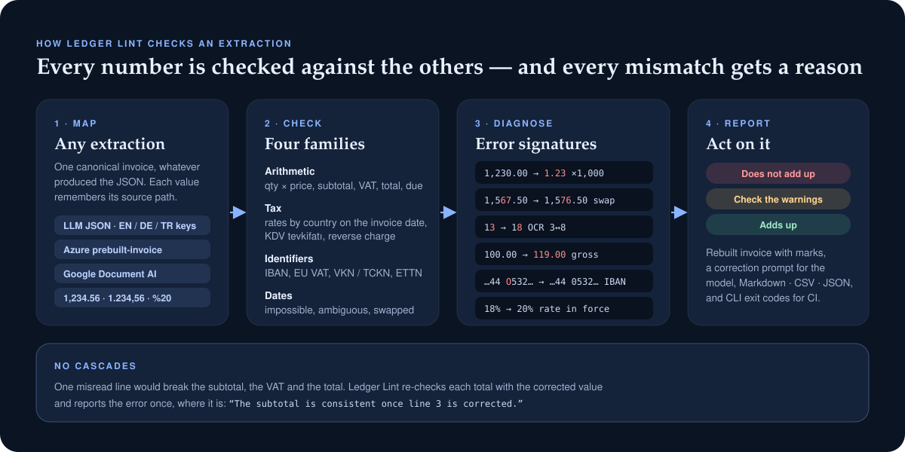
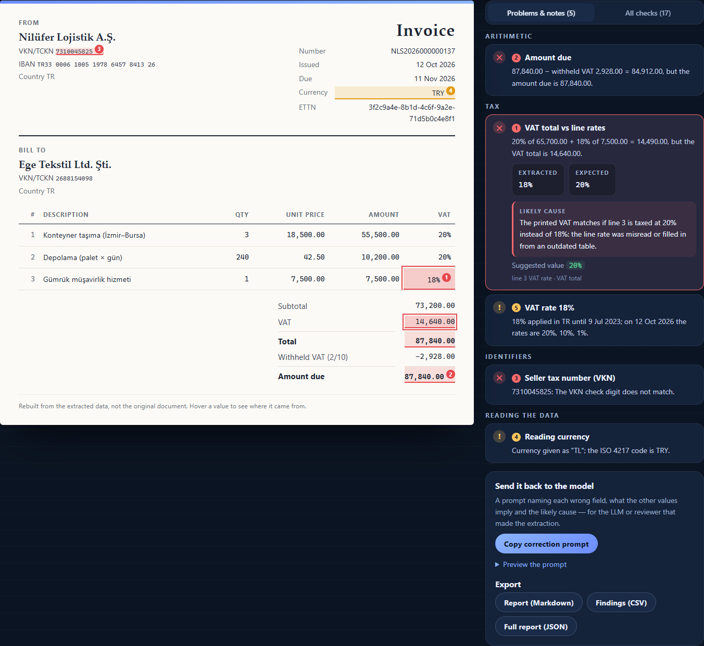
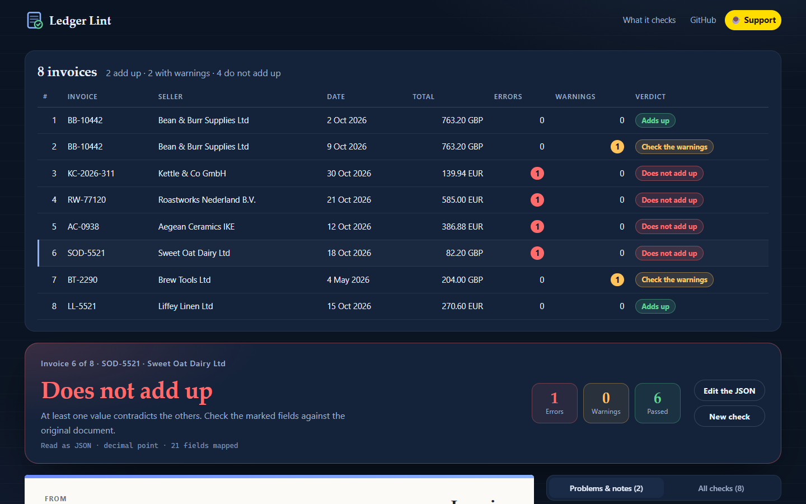

<p align="center">
  
</p>

<h3 align="center">Your extraction pipeline read “1.230,00” as 1.23. Ledger Lint re-does the arithmetic, checks every identifier and tells you why a number is wrong — before it reaches your ledger.</h3>

<p align="center">
  <a href="#quick-start"><b>Quick start</b></a> ·
  <a href="#what-it-checks">What it checks</a> ·
  <a href="#why-a-number-is-wrong">Diagnosis</a> ·
  <a href="#a-tour-of-the-app">Tour</a> ·
  <a href="#command-line-and-pipelines">CLI</a> ·
  <a href="#faq">FAQ</a> ·
  <a href="https://buymeacoffee.com/ufodia">Support ☕</a>
</p>

<p align="center">
  
  
  
  
  
</p>

---

## The problem

Invoices are now read by machines: GPT-style models, Azure Document Intelligence, Google Document AI, OCR plus a prompt. They are fast and usually right. When they are wrong, the output still *looks* right — valid JSON, plausible numbers, every field filled in:

- `1.230,00` becomes **`1.23`** — a thousands separator read as a decimal point;
- `1,567.50` becomes **`1,576.50`** — two digits transposed;
- an **`O`** inside an IBAN, a `3` read as an **`8`** in a quantity;
- a VAT rate “filled in” from training data that is **no longer in force**;
- withheld VAT that was **not deducted** from the amount due.

Each of these is caught by arithmetic the invoice itself already contains — if someone does it.

## The answer

**Ledger Lint** takes the extracted JSON and checks it against itself: every line, every total, every rate, every check digit and every date. When something does not add up, it says **which field is probably wrong, why, and what the value should be** — and writes a correction prompt you can send straight back to the model.

<p align="center">
  
  <br><sub>The synthetic German demo. Three planted errors, three findings — and the subtotal and total are <i>not</i> reported again, because they are consistent once the real errors are corrected.</sub>
</p>

## Who it is for

| You… | Ledger Lint helps you… |
| --- | --- |
| **build invoice or receipt extraction** with an LLM or a document AI service | catch extraction errors automatically and feed a precise correction back to the model |
| **run accounts payable** | stop a misread amount, a wrong IBAN or a duplicate invoice before it is booked or paid |
| **work with Turkish e-Fatura or EU invoices** | check KDV and EU VAT rates *on the invoice date*, tevkifat, VKN/TCKN and EU VAT numbers |
| **evaluate extraction models** | measure which errors each model makes, with the same rules every time |
| **review a batch** | see at a glance which of 50 extractions need a human |

## Quick start

> **Requirements:** Node.js 24 and npm. No account, no API key.

```bash
git clone https://github.com/ufodia/ledger-lint.git
cd ledger-lint
npm ci
npm run dev
```

Open the printed `http://127.0.0.1:5173` address and paste extracted invoice JSON — or open one of the four demos: a German agency invoice, a Turkish e-Fatura, an Azure Document Intelligence result and a batch of eight.

```bash
npm run lint-invoice -- examples/eu-invoice.json      # the same checks on the command line
```

## What it checks

| Family | Checks |
| --- | --- |
| **Arithmetic** | quantity × unit price (− discount) per line, line VAT and gross, subtotal, VAT per rate, total, prepaid, amount due, duplicate lines |
| **Tax** | VAT rates in force in the seller's country **on the invoice date** (EU-27, UK, Switzerland, Norway, Türkiye), mixed rates, VAT breakdowns, KDV tevkifatı (withholding) fractions and amounts, cross-border reverse-charge hints |
| **Identifiers** | IBAN length and ISO 13616 check digits for 88 countries, EU VAT number formats and check digits (AT BE DE DK FI FR IT LU NL PL PT SE), Greek `EL` prefix, Turkish VKN and TCKN, e-Fatura ETTN, seller = buyer, two different IBANs |
| **Dates** | impossible dates (30.02.), day/month ambiguity (04/05/2026), due date before issue date, future issue dates, unusual payment terms, e-Fatura number year vs. issue date |
| **Reading the data** | ambiguous number strings (`"1.234"`), non-ISO currencies (`"TL"`, `"€"`), too many decimals, fields that were not used |

Rounding is told apart from errors: a one-cent gap in a VAT total computed line by line is a **warning with an explanation**, not an error.

## Why a number is wrong

Every mismatch is matched against the signatures of real extraction errors:

| Extracted | Expected | Ledger Lint says |
| --- | --- | --- |
| `1.23` | `1,230.00` | It is 1,000 times too small: a thousands separator was probably read as a decimal point. |
| `1,576.50` | `1,567.50` | Two adjacent digits are transposed (“67” read as “76”). |
| quantity `18` | `13` | The quantity looks wrong. One digit is misread: 8 instead of 3 — a common OCR confusion. |
| `119.00` | `100.00` | It equals the expected value plus 19% VAT: a gross amount was probably taken for a net one. |
| total `585.00` | `637.65` | The total equals the net amount: VAT was not added. |
| `DE89 3704 0044 O532…` | — | Probably `DE89 3704 0044 0532 0130 00`: character 13 looks like “O” but is probably “0”. |
| VAT `14,640.00` with an 18% line | `14,490.00` | The printed VAT matches if line 3 is taxed at 20% instead of 18%: the rate was misread or filled in from an outdated table. |
| amount due `87,840.00` | `84,912.00` | The amount due equals the total: the withheld VAT was not deducted. |

### No cascades

One misread line makes the subtotal, the VAT and the total disagree too. Ledger Lint re-checks each total with the corrected value and reports the error **once, where it is**: *“The subtotal is consistent once line 3 is corrected.”*

## How it works

<p align="center">
  
</p>

1. **Map.** Plain LLM JSON (English, German or Turkish field names), Azure “prebuilt-invoice” results and Google Document AI entities are mapped to one canonical invoice. Every value remembers the path it came from, so findings name *your* field (`line_items[2].amount`). Number strings in either convention (`1,234.56`, `1.234,56`, `%20`) are parsed, and ambiguous ones are flagged.
2. **Check.** Arithmetic, tax rules, identifiers and dates — see above.
3. **Diagnose.** Each mismatch is tested for a factor of 10/100/1,000, transposed or swapped digits, single-digit OCR confusions, dropped or extra digits, flipped signs, gross/net confusion, values copied from another field, a line missing from a sum and outdated VAT rates. For a line, it also works out whether the quantity, the unit price or the amount is the wrong one.
4. **Report.** A verdict, the invoice rebuilt with numbered marks, a correction prompt, Markdown/CSV/JSON reports and CLI exit codes.

Read the full [method](docs/method.md), including the tolerances and the VAT rate sources.

## A tour of the app

<table>
  <tr>
    <td width="62%"></td>
    <td width="38%"></td>
  </tr>
  <tr>
    <td><b>Turkish e-Fatura.</b> Turkish field names and number formats, KDV rates by date, tevkifat and VKN/TCKN check digits.</td>
    <td><b>Send it back.</b> A prompt that names each wrong field, what the other values imply and why — for the model that made the extraction.</td>
  </tr>
  <tr>
    <td></td>
    <td align="center"></td>
  </tr>
  <tr>
    <td><b>Batches.</b> Paste an array or JSON Lines; duplicates across invoices are flagged.</td>
    <td><b>Phone-ready.</b> Check an extraction anywhere.</td>
  </tr>
</table>

## Command line and pipelines

```bash
npm run lint-invoice -- extraction.json [more.json …] [--fail-on error|warning] \
  [--json report.json] [--csv findings.csv] [--prompt fix.txt] [--today 2026-11-14] [--decimal ,|.]
```

Each file may hold one invoice, an array, `{ "invoices": [...] }` or JSON Lines. The Markdown report goes to standard output.

| Exit code | Meaning |
| --- | --- |
| `0` | nothing at or above `--fail-on` (default: `error`) |
| `1` | at least one finding at or above `--fail-on` |
| `2` | usage error or unreadable input |

<details>
<summary><b>Example: the report for the demo batch</b></summary>

```markdown
# Ledger Lint report

8 invoice(s) · 2026-11-14

| # | Invoice | Seller | Total | Errors | Warnings | Verdict |
| ---: | --- | --- | ---: | ---: | ---: | --- |
| 1 | BB-10442 | Bean & Burr Supplies Ltd | 763.20 GBP | 0 | 0 | adds-up |
| 2 | BB-10442 | Bean & Burr Supplies Ltd | 763.20 GBP | 0 | 1 | check-warnings |
| 3 | KC-2026-311 | Kettle & Co GmbH | 139.94 EUR | 1 | 0 | does-not-add-up |
| 4 | RW-77120 | Roastworks Nederland B.V. | 585.00 EUR | 1 | 0 | does-not-add-up |
| 5 | AC-0938 | Aegean Ceramics IKE | 386.88 EUR | 1 | 0 | does-not-add-up |
| 6 | SOD-5521 | Sweet Oat Dairy Ltd | 82.20 GBP | 1 | 0 | does-not-add-up |
| 7 | BT-2290 | Brew Tools Ltd | 204.00 GBP | 0 | 1 | check-warnings |
| 8 | LL-5521 | Liffey Linen Ltd | 270.60 EUR | 0 | 0 | adds-up |
```

</details>

<details>
<summary><b>Example: use it as a library in an extraction pipeline</b></summary>

```ts
import { lintInvoice } from './src/core/lint.ts';
import { correctionPrompt } from './src/core/report.ts';

const extracted = await extractWithYourModel(pdf);          // any JSON shape
let result = lintInvoice(extracted);
if (result.verdict === 'does-not-add-up') {
  const retry = await askYourModelAgain(pdf, correctionPrompt(result));
  result = lintInvoice(retry);
}
if (result.counts.error) sendToHumanReview(result);
```

The engine in `src/core` has no DOM and no dependencies, so it runs the same in Node, a worker or the browser.

</details>

## Exports

| File | Contents |
| --- | --- |
| correction prompt | each wrong field by its input path, what the other values imply, the likely cause and the suggested value — asks the model not to invent values |
| `ledger-lint-report.md` | verdict per invoice and a table of errors and warnings |
| `ledger-lint-findings.csv` | one row per error, warning or note, with the source path, expected and found values, cause and suggestion |
| `ledger-lint-report.json` | the canonical invoice as read, the input format and decimal convention, and every finding including passed checks |

CSV cells that start with `=`, `+`, `-` or `@` are prefixed with `'`, so opening the export in a spreadsheet never executes anything from an invoice.

## Privacy

Invoices contain names, addresses, bank accounts and prices. Ledger Lint parses and checks them **in your browser tab**; the production configuration sends `Content-Security-Policy: connect-src 'none'`, so the page cannot make network requests. Nothing is stored, and there are no analytics, fonts or CDNs. See [docs/privacy.md](docs/privacy.md).

## Honest limitations

- **Consistency, not truth.** Ledger Lint cannot see the original document. If the model misread a value *and* every value that depends on it consistently, the numbers add up and nothing is flagged.
- **Which field is wrong** is a best guess. When several readings explain a mismatch equally well, the amount is blamed first.
- **VAT tables** cover the EU-27, the UK, Switzerland, Norway and Türkiye with the changes up to November 2026. Rates change: an unknown rate is a warning, never an error, and 0 % is always accepted. It is not tax advice.
- **Check digits** are verified for the identifiers listed above; other VAT numbers are checked for format only, and nothing is looked up online (no VIES or GİB queries — that would need a network request).
- **Mapping** is heuristic. Unusual field names may be skipped; they are listed under “Fields not used”.

## FAQ

<details>
<summary><b>Which extraction tools does it work with?</b></summary>

Any that produce JSON: prompts to GPT-, Claude-, Gemini- or Llama-class models, Azure AI Document Intelligence (`prebuilt-invoice`), Google Document AI (invoice parser entities), and your own pipelines. Field names in English, German and Turkish are recognised.
</details>

<details>
<summary><b>Does it call an AI model?</b></summary>

No. Every check is deterministic code, so the same input always gives the same result, and nothing leaves your machine. The correction prompt is text you can send to your own model.
</details>

<details>
<summary><b>Is it an e-invoicing validator (Peppol, XRechnung, UBL, e-Fatura XML)?</b></summary>

No. Those validators check structured XML against a schema. Ledger Lint checks the *values* an extraction produced from a PDF or a photo — which is where reading errors happen.
</details>

<details>
<summary><b>Why does a one-cent difference only produce a warning?</b></summary>

Invoices round VAT either per line or on the total. A difference no larger than half a cent per line is explained by rounding; Ledger Lint shows it as a warning so you can check the method, and keeps errors for real misreadings.
</details>

## Documentation

| Guide | What's inside |
| --- | --- |
| [User guide](docs/user-guide.md) | input formats, reading the result, batches, the correction prompt, exports and troubleshooting |
| [Method](docs/method.md) | mapping, every check, tolerances, the diagnosis signatures, VAT tables and their sources |
| [Architecture](docs/architecture.md) | modules, data model, library use and report formats |
| [Privacy](docs/privacy.md) · [Deployment](docs/deployment.md) | what runs where, and self-hosting with security headers |
| [Changelog](CHANGELOG.md) | release notes |

## Development

```bash
npm run dev            # local development server
npm run check          # strict typecheck, 49 unit tests and a production build
npm run test:browser   # 9 Playwright tests in Chromium
npm run lint-invoice -- examples/batch.json
npm run examples       # rewrite examples/*.json from src/demo.ts
npm run format:check   # Prettier
npm run screenshots    # regenerate README screenshots from the demos
```

The unit tests cover number and date parsing in many conventions, IBAN/VKN/TCKN and twelve EU VAT checksums against published examples, rate validity by date, every diagnosis signature, all three input formats, every planted demo error, batches and reports. See [CONTRIBUTING.md](CONTRIBUTING.md).

## Support

Ledger Lint is free and has no ads. If it stopped a misread invoice from being paid, a coffee keeps it maintained.

<p align="center">
  <a href="https://buymeacoffee.com/ufodia"></a>
</p>

## License

[MIT](LICENSE) © 2026 [ufodia](https://github.com/ufodia). Not affiliated with Microsoft, Google or the Turkish Revenue Administration (GİB).
